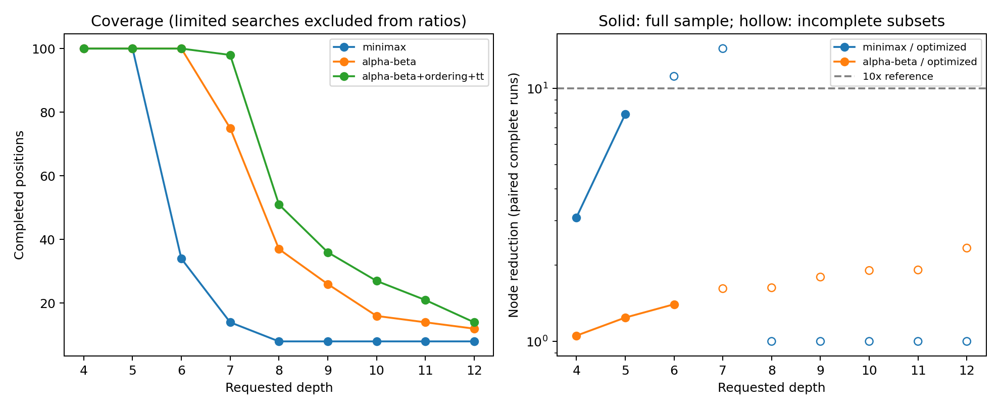
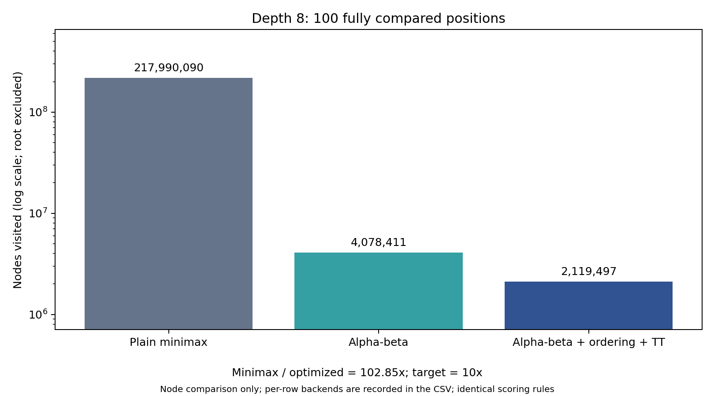
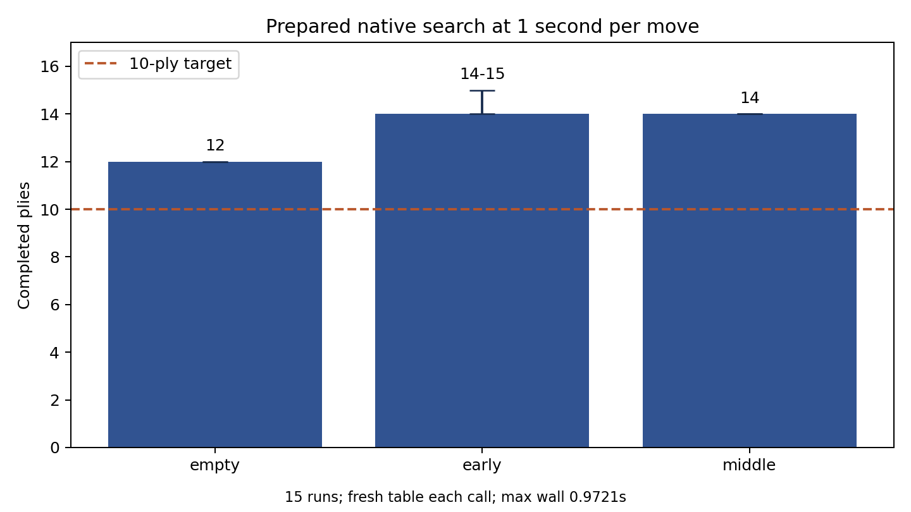

# Rujuta: heuristic evaluation and search efficiency

## Scope and interfaces

Rujuta's modules are `c4/eval_heuristic.py`, `c4/ordering.py`, `c4/tt.py`,
and `eval/node_counts.py`, with their tests. They use Shridali's immutable
bitboard API and optional search hooks without changing the search engine.
The web application and self-play generator already support these hooks.

## Hand-written evaluator

The evaluator scores a board from the perspective of the player to move.
It enumerates all 69 four-cell windows: horizontal, vertical, and both diagonal
directions. An unblocked window with one, two, three, or four own stones has
weight 1, 10, 50, or 500 respectively. Opponent features are subtracted with
the same weights; windows containing both colours contribute zero.
Each centre-column stone contributes 3, and each immediately playable winning
column contributes 200, again subtracting the corresponding opponent feature.
The final Python integer is clamped to [-9999, 9999], as required by
`MAX_HEURISTIC`. These weights are hand chosen, not fitted to experiment data.
Search, rather than the heuristic, assigns proven win/loss scores.

The evaluator is invariant under horizontal reflection. Swapping the two
players' bitboards negates the score. Tests cover these properties, integer
type and bounds, centre control, threats, and preservation of the input board.

## Move ordering

`move_ordering(board, moves, tt_move)` returns the supplied moves without
mutating the input list. It prioritises the table move, immediate wins,
columns blocking an immediate opponent win, and finally proximity to the
centre, breaking equal-distance ties toward the lower column index.
An absent or invalid table move never adds a move to the list.
The search already detects immediate wins before invoking this hook, so the
win-priority rule is useful for the standalone interface but often redundant
inside the current search. The baseline also already uses centre-first order.

## Transposition table

`probe(key)` returns `(depth, value, flag, best_move)` or `None`.
`store(key, depth, value, flag, best_move)` imports the flags EXACT, LOWER,
and UPPER from `c4.search`. The table retains deeper entries, and retains
exact values over bounds at equal depth. It defaults to 100,000 entries,
evicts the oldest inserted key when full, and exposes hit/probe/store counts.
Search owns normalisation of win-distance scores when storing or retrieving
entries; the table stores the values it receives unchanged.

This implementation uses the existing `Board.key()` encoding, not Zobrist
hashing. This matches the supplied search interface. The schedule's separate
mention of Zobrist hashing needs team clarification; no change was made to
teammate-owned board or search files.

## Reproducing the experiment

From the repository root:

```powershell
python -m eval.node_counts --depth 8 --time-limit 120 --count 100 --seed 26 --workers 3 --out results/node_counts.csv --summary results/node_counts_summary.json --plot results/plots/node_counts.png --progress
```

The sample consists of 100 unique legal board keys, generated with seed 26.
Generation cycles target move-sequence lengths 0 through 24. Finished games
and positions with an immediate mover win are rejected, as are duplicate
board keys. Selection does not consult search scores or measured performance.
These are synthetic positions, not a representative sample of human play or
an externally supplied proposal dataset.

For each position, four runs compare baseline, ordering, table, and both.
Every run starts a fresh table, when applicable, while retaining it between
iterative-deepening iterations within that run. All runs use the same heuristic.
The baseline is the existing alpha-beta search with centre-first ordering,
not unpruned minimax. Thus the experiment measures the additional benefit of
the two optional hooks, rather than the benefit of alpha-beta itself.

Node counts include all iterative-deepening iterations. A run may stop before
depth 8 because a result is proven or its time budget expires. The CSV records
both requested and completed depth. Only positions where all four runs finish
depth 8 are included in the principal depth-8 reduction figure. Early-solved
and incomplete runs remain in the raw CSV and are counted separately. Timing
is machine/load dependent and is secondary to node counts.
The saved run uses three independent position workers. Configurations for a
given position are run sequentially within that worker. A single-worker run
is preferable for isolated wall-clock timing; parallel and serial node totals
are tested to agree when they complete the same search depths.

## Results and validation

The run on 2026-11-17 produced 400 rows across 100 positions. All four
configurations completed depth 8 on 82 positions; the other 18 positions were
solved earlier. No positions timed out. Scores agreed across configurations.
The following totals use only the 82 complete depth-8 positions:

| Configuration | Nodes | Sum of search times (seconds) |
|---|---:|---:|
| Baseline | 5,934,640 | 966.99 |
| Ordering | 5,773,011 | 1,218.99 |
| Table | 2,561,761 | 368.55 |
| Table + ordering | 2,526,749 | 512.06 |

The aggregate baseline/combined node ratio was **2.35x**, approximately
57.4% fewer nodes. The median per-position ratio was **2.21x**.
The initially documented **10x hook-improvement target was not met** against
this existing alpha-beta, centre-first baseline. This is not a measurement
against the proposal's plain-minimax baseline. Most node savings came from the table. Tactical
ordering alone saved few nodes and added time; the combined configuration
searched slightly fewer nodes than the table alone but took more time.
These times are sums of per-search durations under three-worker CPU sharing,
not the wall-clock duration of the complete experiment or isolated latency.

Raw measurements are in `results/node_counts.csv`, the machine-readable
summary is `results/node_counts_summary.json`, and experiment notes are in
`results/node_counts_notes.md`.


Tests compare every root-move score with and without the hooks, including
reuse of a warm table. They also cover replacement policy, flags, eviction,
move preservation, reproducible position generation, CSV output, equal-depth
summary exclusions, and parallel/serial equivalence. The final focused suite
passed all 27 tests. A full-suite attempt before the last two tests were added
reported 144 passed, 5 skipped, and one failure: the self-play network test
imports `torch`, which is not installed in this environment. That dependency
failure is outside these modules; teammate files were not changed.

## Limitations and handoff

The table is FIFO at capacity, rather than a bucketed or age/depth replacement
scheme. The heuristic does not model every long-term parity or strategic
pattern. Ordering adds tactical checks, whose Python overhead can outweigh
node savings. The baseline's existing centre-first order limits the potential
gain from the ordering hook. The original proposal was unavailable for the
initial experiment, which followed `docs/EVAL.md` and the supplied schedule.
The proposal was supplied on 2026-11-18 and its broader experiment is addressed
in the fixed-depth sweep below. Shridali's report also documents the exact
bitboard key as a replacement for Zobrist hashing. The team should confirm
that this documented design deviation is acceptable before the final
report claims complete proposal compliance.

## Proposal fixed-depth sweep (2026-11-18)

The original proposal specifies plain minimax, alpha-beta, and alpha-beta with
ordering/table on 100 fixed positions over depths 4 through 12. This differs
from the initial hook-only experiment above. The new runner uses the same
seed-26 sample (and identical move strings), all nine integer depths, and three
configurations: `minimax`, `alpha-beta`, and `alpha-beta+ordering+tt`.

```powershell
python -m eval.node_counts --depths 4 5 6 7 8 9 10 11 12 --count 100 --seed 26 --workers 6 --node-limit 20000 --time-limit 10 --out results/node_counts_sweep.csv --summary results/node_counts_sweep_summary.json --plot results/plots/node_counts_sweep.png --progress
```

Each run searches a single requested depth, without iterative deepening or
early stopping just because one root move has a proven score. All root moves
are evaluated with full windows. Nodes count recursive calls below the root;
the root itself is excluded, matching the production counter convention.
Minimax exhaustively visits the children of every nonterminal node, with no
alpha-beta cutoffs and no table. Both other paths use the existing production
alpha-beta implementation through its internal search helper, without editing
Shridali's files. All three use centre-first baseline order, the same heuristic,
and the production full-board/immediate-win prechecks (including immediate-win
recognition before horizon evaluation). Thus these are comparisons under the
production tactical-terminal convention, not an entirely naive tree generator.
Every optimized run has a fresh table; nothing persists across positions or
depths. Every completed run records all root scores for cross-checking.

Unpruned search on the opening positions grows exponentially. To keep the
experiment runnable on this workstation, each run is limited to 20,000 nodes
and 10 seconds, with six position/configuration workers. A limited run is
recorded as `node_limit` or `time_limit`, has completed depth 0, and publishes
no score, chosen move, or root scores. Its partial node count is work actually
performed, **not** its completed-tree count. Such rows are excluded from all
reduction ratios. These bounds are an operational limitation, not evidence
that the full proposal experiment has been completed.

The summary includes coverage by algorithm/depth, all-three-complete totals,
and ratios on matching completed pairs only. The paired subset changes with
depth and disproportionately includes easier positions. It must not be
presented as a full-100-position result or compared across depths as a fixed
cohort. A 10x result on a subset cannot establish the full proposal target.
The plot shows coverage alongside the subset ratios to make this visible.

The CSV is flushed after each job. Add `--resume` to the same command after
an interruption; sample, depths and resource limits must match. To raise limits,
use a separate output path to preserve provenance. `--node-limit 0` disables
the node cap, but the time limit still applies. Full unbounded-style runs may
take many hours or days; the runner never extrapolates missing node counts.

### Saved sweep results and remaining coverage

All 2,700 attempts are saved: 1,315 completed, 1,360 stopped at the node cap,
and 25 stopped at the time cap. Completed root-score vectors agree wherever
more than one configuration completed for a position/depth.

| Depth | Minimax completed / 100 | Alpha-beta completed / 100 | Optimized completed / 100 |
|---|---:|---:|---:|
| 4 | 100 | 100 | 100 |
| 5 | 100 | 100 | 100 |
| 6 | 34 | 100 | 100 |
| 7 | 14 | 75 | 98 |
| 8 | 8 | 37 | 51 |
| 9 | 8 | 26 | 36 |
| 10 | 8 | 16 | 27 |
| 11 | 8 | 14 | 21 |
| 12 | 8 | 12 | 14 |

Only depths 4 and 5 provide complete three-way comparisons over the entire
100-position sample:

| Depth | Minimax nodes | Alpha-beta nodes | Optimized nodes | Minimax / optimized |
|---|---:|---:|---:|---:|
| 4 | 161,091 | 54,920 | 52,118 | 3.09x |
| 5 | 979,765 | 153,863 | 123,896 | 7.91x |

At depths 8 through 12 the eight completed minimax positions are trivial under
the shared immediate-win precheck (61 nodes in total per depth). Their 1x
subset ratio is selection bias, not a measurement of general deep-search
efficiency. Depth-6 and depth-7 subset ratios also do not cover the whole sample.
Accordingly this bounded sweep alone left the full-100-position depth-8 10x
proposal target **not fully measured**. The later complete depth-8 study below
supersedes that verdict for depth 8.

The benchmark implementation and bounded sweep are complete, but the requested
exhaustive comparison for every position at depths 6 through 12 was incomplete
under these limits. A subsequent study completes depth 8 below; the remaining
depths still require a larger budget. Completing that numerical coverage requires a
larger compute/time budget. For example, use a separate output file with
`--depths 6 7 8 9 10 11 12 --node-limit 0 --time-limit 86400` to permit up to
one day per search; that is permission for longer attempts, not a guarantee
that all trees finish. Keep both artifacts and distinguish their resource
limits. A time-limited result must never be substituted for a completed tree.

The detailed files are `results/node_counts_sweep.csv`,
`results/node_counts_sweep_summary.json`, and `results/node_counts_sweep_notes.md`.
The extended focused suite passes 38 tests. No production search, board,
evaluator-interface, or teammate experiment files were changed.



## Completed depth-8 proposal comparison (2026-11-18)

The original 100 positions have now been fully compared at depth 8. All 300
runs completed with no node cap and a one-hour safety deadline per run; none
hit the deadline. Every root-move score agrees across all three algorithms.

| Method | Nodes over all 100 positions | Minimax / method |
|---|---:|---:|
| Plain minimax | 217,990,090 | 1.00x |
| Alpha-beta | 4,078,411 | 53.45x |
| Alpha-beta + ordering + table | 2,119,497 | **102.85x** |

**The proposal's 10x depth-8 node-reduction target is met on this fixed sample.**
The optimized/minimax comparison covers all 100 positions, not a selected
completed subset. The additional gain over alpha-beta alone is **1.92x** in
this fixed-depth protocol. The earlier **2.35x** result used iterative deepening
and early decided-root stopping, and therefore remains a separate experiment.
Neither ratio should be substituted for the other.

### Making the exhaustive baseline practical without changing its tree

The Python minimax traversal was too slow at the earlier limits. A small C++
kernel embedded in `eval/node_counts.py` now performs the same actual
exhaustive minimax traversal, with no alpha-beta pruning, caching, table,
memoization, estimated counts, or early root-result stopping. It uses the
identical bitboard layout, centre-first order, 69-window heuristic weights,
centre/threat bonuses, score clamp, and shared immediate-win terminal shortcut.
Every visited node is physically traversed and counted. Both alpha-beta
configurations still use the production Python search helper unchanged.

The optional kernel compiles with g++/clang++ to a temporary directory; no
executable or extra source file is committed. This run used MSYS2 g++ 15.2.0
with `-static -O3 -march=native -std=c++17`. Source SHA-256 and validation
details are saved in `results/native_minimax_validation.json`. The native
counter exactly matched **all 288 completed saved Python minimax runs** across
depths 4-12 on nodes, chosen move, best score, and every root score. These
include all 100 positions at depths 4 and 5. At depth 8 its root-score vectors
also match both Python alpha-beta variants for all 100 positions.

The experiment compares **node counts**, not language-independent execution
speed. Native minimax times must not be used to claim a Python wall-clock
speedup or slowdown. The common immediate-win shortcut means this is the
production-compatible minimax baseline, not a naive traversal without tactical
terminal recognition. The result applies to this sample and protocol; it is
not a proof of a universal speedup on every Connect-4 position.

```powershell
python -m eval.node_counts --depths 8 --count 100 --seed 26 --workers 4 --node-limit 0 --time-limit 3600 --native-minimax --out results/node_counts_depth8_complete.csv --summary results/node_counts_depth8_complete_summary.json --plot results/plots/node_counts_depth8_complete.png --progress
```

Use `--resume` with the same arguments after an interruption. At the time of
this node-count experiment, the compiler was used only for its minimax baseline
and production search remained Python. An optional production accelerator was
added afterward, separately documented below. This experiment's focused suite
passed **44 tests**.

Raw results, summary, and protocol notes are saved in
`results/node_counts_depth8_complete.csv`,
`results/node_counts_depth8_complete_summary.json`, and
`results/node_counts_depth8_complete_notes.md`. The older limited sweep is
preserved unchanged. Full 100-position comparisons at depths 6, 7, and 9-12
remain limited; meeting the depth-8 target does not establish those results.



## Opt-in native search-depth target (2026-11-18)

The pure-Python trials did not reliably reach 10 plies per second and were
rolled back. With the user's permission, an optional C++ production-search
backend was added in `c4/native_search.cpp` and `c4/native_search.py`, with a
small dispatch addition to Shridali's `search.py` and a native-storage bridge
in Rujuta's `tt.py`. The original Python engine remains the default. Other
evaluator/ordering/table implementations continue to use Python.

On the exact positions consumed by `eval/measure_search.py`, five repetitions
per position with fresh tables produced:

| Position (move string) | Completed plies in native mode |
|---|---:|
| Empty | 12 |
| Early (`332432`) | 14-15 |
| Middle (`33243244152251`) | 14 |

All **15 externally timed calls** finished within the requested one second;
the maximum was **0.9722 seconds**. Thus the prepared native heuristic mode
meets the 10-ply target on this measurement set. This is a documented native
implementation deviation, **not** evidence that pure Python now meets it or a
guarantee across arbitrary positions/hardware. One-time compilation/loading
is setup, excluded from the per-move clock and recorded separately. Each call
includes its own native table creation and Python trace marshalling; a 0.03 s
reserve is subtracted from the internal budget, not added to the deadline.

The C++ code preserves the same heuristic, terminal/horizon convention,
alpha-beta/iterative-deepening algorithm, full-window scoring of every root
move, table flags/replacement, win-distance normalization, and SearchTrace
outputs. It does not reduce depths or drop root alternatives. Its evaluator
matched Python on 4,198 legal positions. All 100 fixed sample positions were
checked against the completed depth-8 artifact or, for the 18 early-decided
positions, the corresponding Python traces. All checked root scores and PV
legality agree. Native storage preserves the public table API and can be
cleared or queried normally.

The native/core focused suite passed 44 tests. The broader integration suite
with automatic native dispatch enabled passed **132 tests, 2 skipped**.

```powershell
python -m c4.native_search --backend native --repeats 5 --time-limit 1 --measure results/search_depth_native.json --plot results/plots/search_depth_native.png
```

For the app, prepare the accelerator once and opt in:

```powershell
python -c "from c4.native_search import prepare_native_search; prepare_native_search()"
$env:C4_SEARCH_BACKEND = 'auto'
python -m uvicorn web.app:app --reload
```

The optional backend needs g++/clang++ at setup; the tested compiler was MSYS2
g++ 15.2.0. Build products stay in a temporary cache. Automatic mode falls back
to Python if unsupported/unavailable; explicit `backend='native'` fails clearly
instead. `backend='python'` always retains the reference path.

The evidence and full qualifications are in `results/search_depth_native.json`,
`results/native_search_validation.json`, and `results/search_depth_native_notes.md`.
Earlier match results describe the original Python engine and must not be
presented as matches against this new accelerated mode. The other incomplete
depth-sweep results are not filled in by this three-position timing experiment.



Code and test drafting, experiment preparation, and this report draft used
OpenAI Codex assistance. See Rujuta's entry in `docs/AI_USAGE.md` for the
distinction between automated checks and checks personally run by the member.
