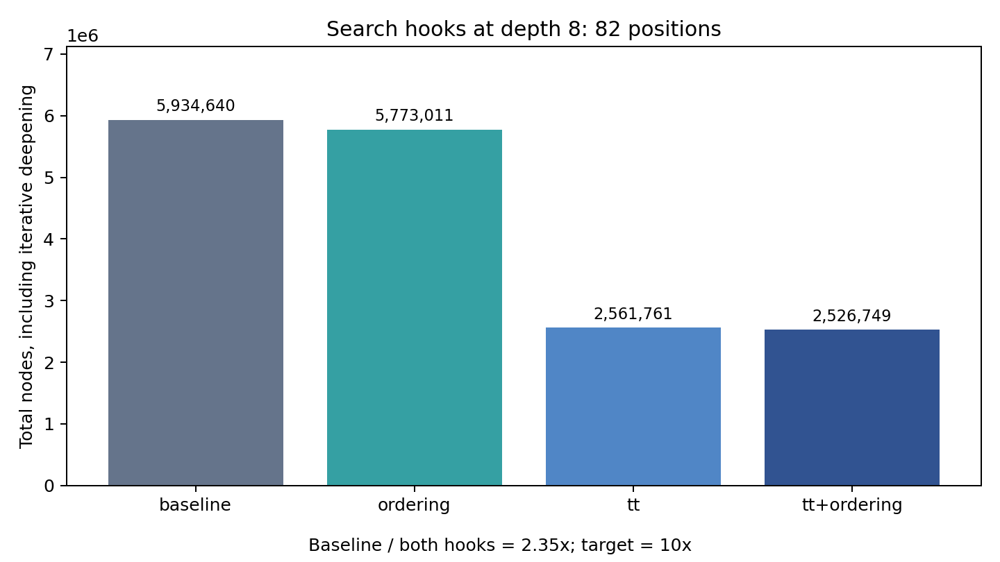

# Rujuta: heuristic evaluation and search efficiency

## Scope and interfaces

Rujuta's modules are `c4/eval_heuristic.py`, `c4/ordering.py`, `c4/tt.py`,
and `eval/node_counts.py`, with their tests. They use Shridali's immutable
bitboard API and optional search hooks without changing the search engine.
The web application and self-play generator already support these hooks.

## Hand-written evaluator

The evaluator scores a board from the perspective of the player to move.
It enumerates all 69 four-cell windows: horizontal, vertical, and both diagonal
directions. An unblocked window with one, two, three, or four own stones has
weight 1, 10, 50, or 500 respectively. Opponent features are subtracted with
the same weights; windows containing both colours contribute zero.
Each centre-column stone contributes 3, and each immediately playable winning
column contributes 200, again subtracting the corresponding opponent feature.
The final Python integer is clamped to [-9999, 9999], as required by
`MAX_HEURISTIC`. These weights are hand chosen, not fitted to experiment data.
Search, rather than the heuristic, assigns proven win/loss scores.

The evaluator is invariant under horizontal reflection. Swapping the two
players' bitboards negates the score. Tests cover these properties, integer
type and bounds, centre control, threats, and preservation of the input board.

## Move ordering

`move_ordering(board, moves, tt_move)` returns the supplied moves without
mutating the input list. It prioritises the table move, immediate wins,
columns blocking an immediate opponent win, and finally proximity to the
centre, breaking equal-distance ties toward the lower column index.
An absent or invalid table move never adds a move to the list.
The search already detects immediate wins before invoking this hook, so the
win-priority rule is useful for the standalone interface but often redundant
inside the current search. The baseline also already uses centre-first order.

## Transposition table

`probe(key)` returns `(depth, value, flag, best_move)` or `None`.
`store(key, depth, value, flag, best_move)` imports the flags EXACT, LOWER,
and UPPER from `c4.search`. The table retains deeper entries, and retains
exact values over bounds at equal depth. It defaults to 100,000 entries,
evicts the oldest inserted key when full, and exposes hit/probe/store counts.
Search owns normalisation of win-distance scores when storing or retrieving
entries; the table stores the values it receives unchanged.

This implementation uses the existing `Board.key()` encoding, not Zobrist
hashing. This matches the supplied search interface. The schedule's separate
mention of Zobrist hashing needs team clarification; no change was made to
teammate-owned board or search files.

## Reproducing the experiment

From the repository root:

```powershell
python -m eval.node_counts --depth 8 --time-limit 120 --count 100 --seed 26 --workers 3 --out results/node_counts.csv --summary results/node_counts_summary.json --plot results/plots/node_counts.png --progress
```

The sample consists of 100 unique legal board keys, generated with seed 26.
Generation cycles target move-sequence lengths 0 through 24. Finished games
and positions with an immediate mover win are rejected, as are duplicate
board keys. Selection does not consult search scores or measured performance.
These are synthetic positions, not a representative sample of human play or
an externally supplied proposal dataset.

For each position, four runs compare baseline, ordering, table, and both.
Every run starts a fresh table, when applicable, while retaining it between
iterative-deepening iterations within that run. All runs use the same heuristic.
The baseline is the existing alpha-beta search with centre-first ordering,
not unpruned minimax. Thus the experiment measures the additional benefit of
the two optional hooks, rather than the benefit of alpha-beta itself.

Node counts include all iterative-deepening iterations. A run may stop before
depth 8 because a result is proven or its time budget expires. The CSV records
both requested and completed depth. Only positions where all four runs finish
depth 8 are included in the principal depth-8 reduction figure. Early-solved
and incomplete runs remain in the raw CSV and are counted separately. Timing
is machine/load dependent and is secondary to node counts.
The saved run uses three independent position workers. Configurations for a
given position are run sequentially within that worker. A single-worker run
is preferable for isolated wall-clock timing; parallel and serial node totals
are tested to agree when they complete the same search depths.

## Results and validation

The run on 2026-11-17 produced 400 rows across 100 positions. All four
configurations completed depth 8 on 82 positions; the other 18 positions were
solved earlier. No positions timed out. Scores agreed across configurations.
The following totals use only the 82 complete depth-8 positions:

| Configuration | Nodes | Sum of search times (seconds) |
|---|---:|---:|
| Baseline | 5,934,640 | 966.99 |
| Ordering | 5,773,011 | 1,218.99 |
| Table | 2,561,761 | 368.55 |
| Table + ordering | 2,526,749 | 512.06 |

The aggregate baseline/combined node ratio was **2.35x**, approximately
57.4% fewer nodes. The median per-position ratio was **2.21x**.
The documented **10x target was not met** against this existing alpha-beta,
centre-first baseline. Most node savings came from the table. Tactical
ordering alone saved few nodes and added time; the combined configuration
searched slightly fewer nodes than the table alone but took more time.
These times are sums of per-search durations under three-worker CPU sharing,
not the wall-clock duration of the complete experiment or isolated latency.

Raw measurements are in `results/node_counts.csv`, the machine-readable
summary is `results/node_counts_summary.json`, and experiment notes are in
`results/node_counts_notes.md`.



Tests compare every root-move score with and without the hooks, including
reuse of a warm table. They also cover replacement policy, flags, eviction,
move preservation, reproducible position generation, CSV output, equal-depth
summary exclusions, and parallel/serial equivalence. The final focused suite
passed all 27 tests. A full-suite attempt before the last two tests were added
reported 144 passed, 5 skipped, and one failure: the self-play network test
imports `torch`, which is not installed in this environment. That dependency
failure is outside these modules; teammate files were not changed.

## Limitations and handoff

The table is FIFO at capacity, rather than a bucketed or age/depth replacement
scheme. The heuristic does not model every long-term parity or strategic
pattern. Ordering adds tactical checks, whose Python overhead can outweigh
node savings. The baseline's existing centre-first order limits the potential
gain from the ordering hook. The original proposal itself was not available
in this checkout; the experiment follows `docs/EVAL.md` and the supplied team
schedule. Shridali should confirm the hashing requirement before the final
report claims complete proposal compliance.

Code and test drafting, experiment preparation, and this report draft used
OpenAI Codex assistance. See Rujuta's entry in `docs/AI_USAGE.md` for the
distinction between automated checks and checks personally run by the member.
