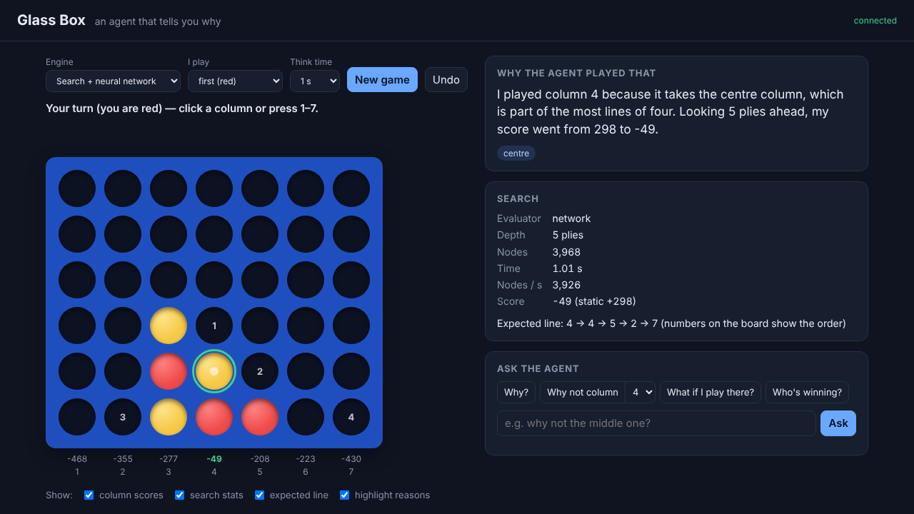
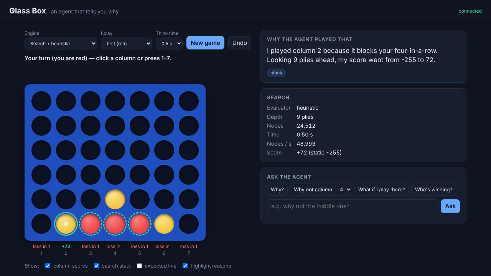
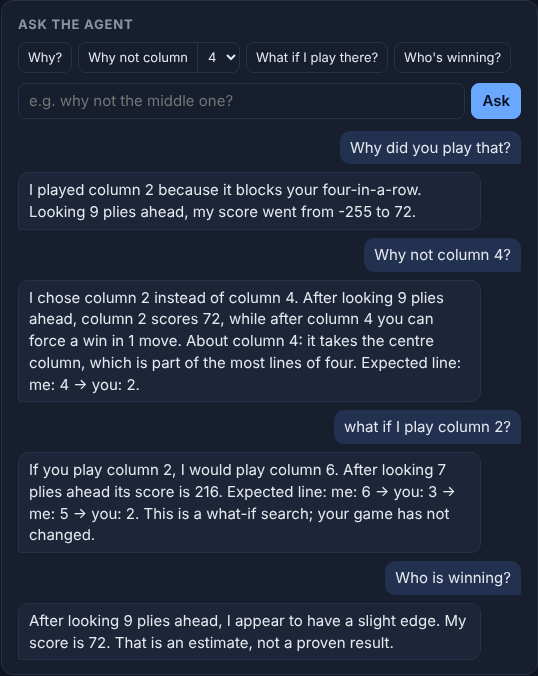

# Srikar: web interface

## Scope and interfaces

Srikar's modules are `web/app.py` (the server) and `web/static/` (`index.html`,
`app.js`, `style.css`), with their tests in `tests/test_web.py` (9 tests). The
interface is where every other part of the project meets the user: the search and
the evaluators choose the move, the explanation layer says why, and the question
answering layer handles follow-up questions. The web code only reads these parts
and never changes them. It uses three entry points:

* `agent.play_turn(game) -> TurnResult` (Shridali, `c4/agent.py`) for the agent's
  move, its `SearchTrace` and its `Explanation`.
* `game.record_agent_turn(result)` and `game.apply_move(col)` (`c4/game.py`) to keep
  one `GameState` per browser tab.
* `answer(question, game) -> str` (Aditya, `c4/qa/answers.py`) for typed questions.

## How a move travels

The server is a FastAPI application. Each browser tab opens one WebSocket and gets
its own session (a `GameState` plus the agent chosen for that game). The browser
sends small JSON messages (`new_game`, `move`, `undo`, `ask`) and the server answers
with a `state` message after every change. A state message holds the board, whose
turn it is, the legal columns, the result and winning cells if the game is over,
and, after an agent move, the explanation and the search numbers taken from the
trace: chosen column, depth, nodes, time, root score, static score and, for every
legal column, its score and expected line (principal variation).

The search runs in a worker thread (`asyncio.to_thread`), so the server stays
responsive while the agent thinks, and the page shows "Agent is thinking". Scores
are shown from the agent's point of view, following the trace's convention: a
decided score becomes "win in n" or "loss in n", anything else is shown as a
number.

## What the page shows

The page is built around one idea from the proposal: the user should be able to
see the evidence behind each explanation, not only the sentence.

* **Explanation panel.** The sentence from `explain_move` and the concepts it used
  (for example `block`, `centre`, `sacrifice`, `saliency`).
* **Highlighted reasons.** The cells of every fact behind the explanation are
  outlined on the board: the target cell solid, the stones of its line dashed.
* **Column scores.** The exact search score of every legal column, shown under the
  board, with the chosen column in green. This is possible because Shridali's
  search gives every root move a full window, so losing columns have exact scores
  rather than bounds.
* **Search stats.** Evaluator, depth reached, nodes, time and nodes per second.
* **Expected line.** The principal variation of the chosen move, numbered on the
  board in the order the agent expects the moves to be played.

Each of the four can be switched on and off. The controls offer the engine
(heuristic, network, or a random stub used for testing), who moves first, the think
time (0.5 to 5 s) and Undo, which takes back the human's last move and the agent's
reply.



Figure 1 shows a game against the network engine with all four views on. In
Figure 2 the heuristic agent blocks a three-in-a-row: the three red stones of the
line are outlined, and the column scores show why there was no real choice, since
every other column is "loss in 1".



On the machine used for these screenshots, the heuristic engine searched about
48,000 nodes per second (depth 8 to 9 in 0.5 s) and the network engine about 3,000
to 4,000 nodes per second (depth 4 to 5 in 1 s), which matches the speed gap
Sriyanth reports.

## Asking questions

The question box offers buttons for the four question types ("Why?", "Why not
column n?", "What if I play there?", "Who's winning?") and a free-text field, so
wordings such as "what if I play the middle one?" go through Aditya's parser
unchanged (Figure 3).



"What if" and "who is winning" may need a new search. Aditya's robustness check
found that the page did not tell the question layer which agent the game uses, so
these searches always used the heuristic, even in network games. The fix sets
`game.agent` to the session's agent just before each question is answered. Doing
it there rather than at the start of the game also covers Undo, which creates a new
`GameState`. It was checked with Aditya's PR #10 merged: both questions now search
with the game's own engine, also after Undo.

## Plugging in the other parts

The web code was written before most of the other parts existed, against the stub
agent. Like `c4/agent.py`, it looks the other modules up when they are needed:
`HeuristicEvaluator`, `TranspositionTable` and `move_ordering` (Rujuta),
`NNEvaluator` (Sriyanth) and `answer` (Aditya). Each was used automatically once it
was merged, with no change to the web code. The engine menu marks an engine as not
ready, with the reason, when its module or the network weights
(`models/nn_latest.pt`) are missing, and falls back to the stub.

## Testing

`tests/test_web.py` checks that the page and static files load, that a human move
gets an agent reply with an explanation and a score for every column, that the
agent moves first when the human plays second, that illegal and out-of-turn moves
are rejected, that Undo returns to the human's turn, that questions get an answer,
the engine fallback, and the winning-cell and score-text helpers. The full suite on
main 56216dc passed (178 tests, including these 9). The page was also played end to
end on the stub, with Rujuta's and Naman's branches merged before they reached main,
and with the round 2 network for the demo video.

## Limitations

* The engine menu is built when the server starts, by importing the evaluators.
  If `torch` is not installed, that import fails and the page does not load, instead
  of only marking the network as not ready. On the demo laptop all of
  `requirements.txt` is installed, so this does not affect the demo, but the check
  should catch a missing dependency as well as a missing module.
* Sessions live in the server's memory: one process, no saved games, no accounts.
  This is enough for a demo and the rating study, not for many users at once.
* The demo runs on a laptop (`uvicorn web.app:app`) rather than an online host. The
  network engine needs `torch` and the weights file, which free hosting services
  handle poorly.
* Undo clears the explanation panel until the agent moves again, because the old
  explanation no longer matches the board.

## Reproducing

```
pip install -r requirements.txt
# put the shared nn_latest.pt into models/ for the network engine
uvicorn web.app:app
```

Then open http://127.0.0.1:8000. `pytest tests/test_web.py` runs the web tests.

The web code, its tests, the demo video and this report draft were made with
Claude's help. See Srikar's entry in `docs/AI_USAGE.md`.
